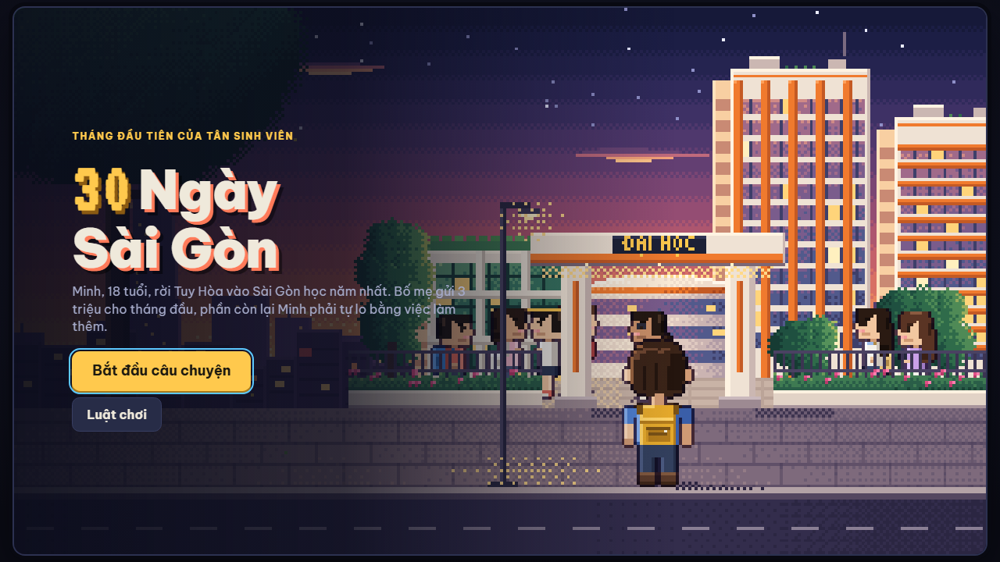
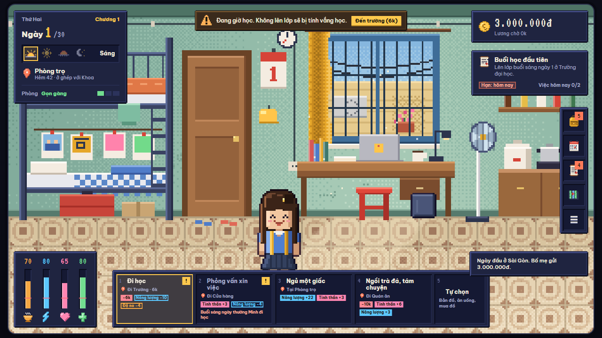
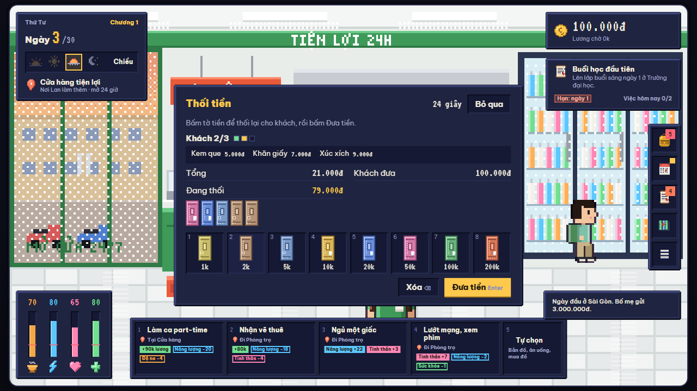
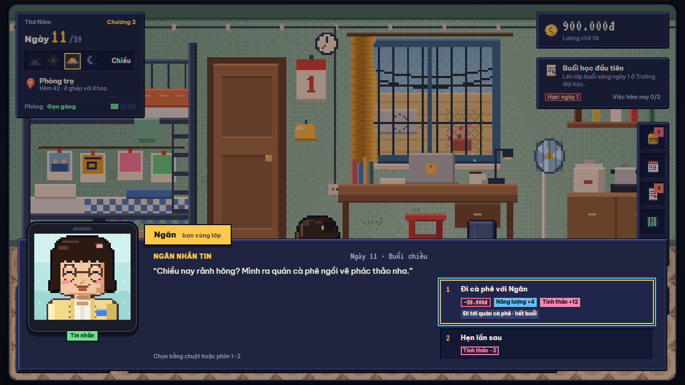
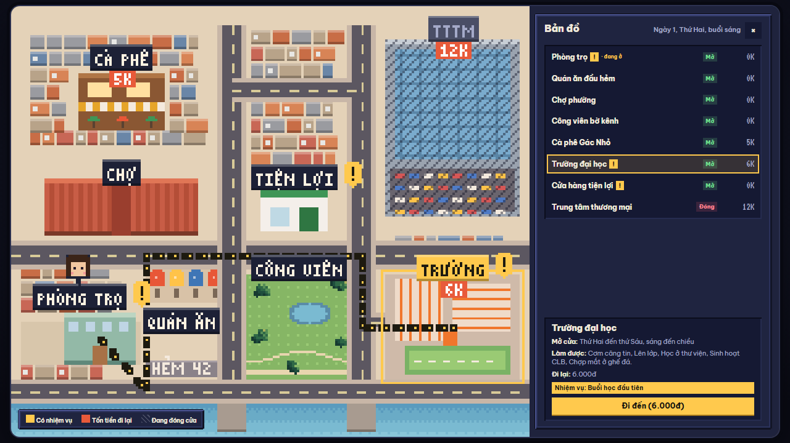
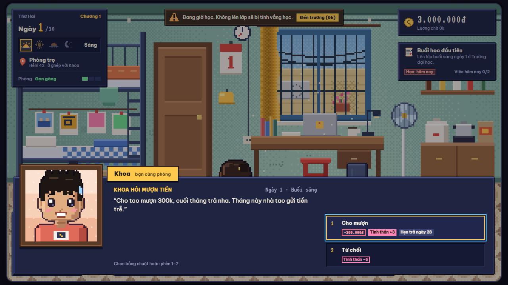
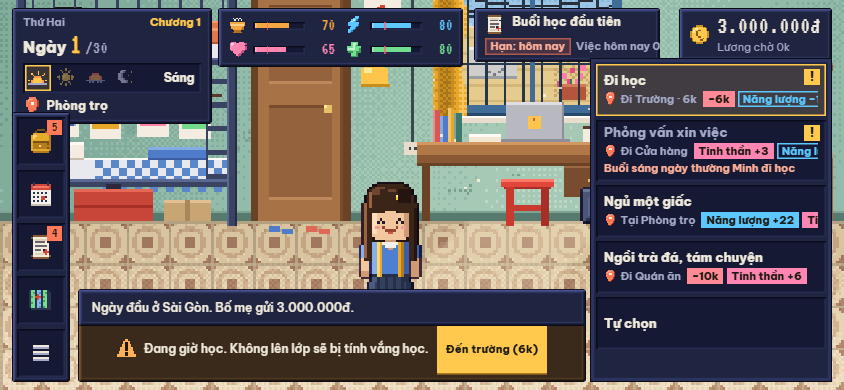

<div align="center">


# 30 Ngày Sài Gòn

**Game mô phỏng chi tiêu có cốt truyện.** Giúp một tân sinh viên vừa học vừa làm thêm, sống qua tháng đầu tiên ở Sài Gòn: học đủ, làm đủ, còn tiền, còn khỏe, còn vui.

Pixel art · Chơi trên trình duyệt (máy tính, điện thoại nằm ngang) · Tiếng Việt · Phiên bản `0.4.0`

</div>

---

## Giới thiệu

Người chơi đặt tên, chọn Nam hoặc Nữ cho nhân vật 18 tuổi rời Tuy Hòa vào Sài Gòn học năm nhất (tên mặc định là Minh). Bố mẹ gửi 3 triệu cho tháng đầu, phần còn lại nhân vật tự lo bằng việc làm part-time ở cửa hàng tiện lợi. Mỗi ngày có 4 buổi; mỗi buổi có 3 đến 5 thẻ hành động gợi ý (lên lớp, đi làm, tự học, nghỉ ngơi hay đi chơi), bấm một thẻ là tự đi tới nơi và làm luôn, hoặc mở Tự chọn để tự quyết từng bước. Cuối tháng, game chấm điểm theo tài sản, độ no, tinh thần, sức khỏe và điểm học tập, đồng thời kể lại kết cục với từng nhân vật.

- **4 chương** theo 4 tuần: Tân sinh viên · Vừa học vừa làm · Lương part-time đầu tiên · Về đích
- **14 nhiệm vụ chính** và 2 việc nhỏ mỗi ngày dẫn dắt người chơi
- **Học và làm**: lên lớp mỗi sáng, ca part-time trưa, chiều, tối, điểm học tập và bài kiểm tra giữa kỳ
- **Thẻ hành động** theo buổi, một ngày thường chỉ khoảng 5 lần bấm; **thẻ ăn** hiện 2–3 món ăn được ngay, bấm là ăn
- **Hai độ khó**: Thường (hao hụt và hình phạt tăng dần theo chương) và Dễ
- **Bộ bài sự kiện** 20 sự kiện ngẫu nhiên có giới hạn số lần và thời gian chờ; hộp cảnh báo cho việc quan trọng
- **Minigame** Thối tiền khi làm ca và Canh lửa khi nấu cơm
- **8 địa điểm** pixel 320×180, đổi theo sáng, trưa, chiều, tối và theo tiến độ; lên lớp, làm ca, ăn ở quán, ngồi cà phê có cảnh hành động riêng
- **Nhân vật** đổi trang phục và biểu cảm theo chỉ số; 8 chân dung có biểu cảm trong hội thoại, gồm Ngân, bạn cùng lớp hay rủ đi cà phê
- **Túi đồ** 9 vật phẩm có hạn dùng, **lịch tháng**, **bản đồ**, **nhật ký**, **điện thoại** trong phòng trọ
- **Phòng trọ** bừa dần theo sinh hoạt, phải dọn để giữ tinh thần
- **Kinh tế sinh viên**: tiền bố mẹ chu cấp, lương part-time ngày 15, tiền nhà, giáo trình, ứng lương, xin thêm tiền bố mẹ. Không có vay; thiếu tiền hóa đơn thì mất hết tiền trong ví và tinh thần

| | |
| --- | --- |
|  |  |
|  |  |
|  |  |




## Chạy game

**Chơi thử ngay:** https://tdat10052499.github.io/30-ngay-sai-gon/

Game là một trang web tĩnh, không cần cài đặt hay build.

**Cách 1: mở trực tiếp**
Tải repo về, bấm đúp vào `index.html`.

**Cách 2: chạy qua máy chủ cục bộ** (khuyên dùng khi phát triển)

```bash
python3 -m http.server 8080
# mở http://localhost:8080
```

Font chữ (Be Vietnam Pro, VT323) tải từ Google Fonts. Khi không có mạng, game vẫn chạy với font dự phòng của hệ thống.

### Điều khiển

| Phím | Chức năng |
| --- | --- |
| `B` | Túi đồ |
| `L` | Lịch tháng |
| `J` | Nhiệm vụ |
| `M` | Bản đồ |
| `N` | Nhật ký |
| `1`–`5` | Chọn thẻ hành động (trong Tự chọn: mở nhóm hành động); trong hội thoại: chọn lựa chọn; trong Thối tiền: chọn tờ tiền |
| `Enter`, `⌫` | Thối tiền: đưa tiền, xóa |
| `Space` | Hiện hết lời thoại đang chạy; Canh lửa: dừng vạch |
| `Esc` | Đóng cửa sổ hoặc menu; quay lại thẻ gợi ý; bỏ qua minigame |

Mọi thao tác khác đều bấm chuột hoặc chạm. Trên điện thoại, xoay ngang màn hình để chơi.

## Cấu trúc thư mục

```
30-ngay-sai-gon/
├── index.html              Trang game (khung HTML của màn hình)
├── src/
│   ├── rules.js            Luật theo độ khó Thường và Dễ, công thức điểm
│   ├── events.js           Bộ bài sự kiện ngẫu nhiên
│   ├── cards.js            Chọn thẻ hành động và món cho thẻ ăn
│   ├── minigames.js        Minigame Thối tiền và Canh lửa
│   ├── audio.js            Nhạc nền và hiệu ứng (Web Audio)
│   ├── game.js             Logic game: trạng thái, cốt truyện, nhiệm vụ, sự kiện, giao diện, chọn cảnh
│   ├── style.css           Giao diện: HUD, cửa sổ, màn mở đầu, bố cục điện thoại nằm ngang
│   └── gfx/                Đồ họa canvas, gom từ design/
│       ├── core.js         Công cụ vẽ chung: dither, viền tối, font pixel có dấu, phủ màu theo buổi
│       ├── characters.js   Nhân vật chính (trang phục, biểu cảm, bong bóng) và nhân vật phụ
│       ├── money.js        Tờ tiền pixel 12×24
│       ├── portraits.js    8 chân dung 48×48 có biểu cảm
│       ├── icons.js        Biểu tượng HUD và vật phẩm 12×12
│       └── scenes/         Từng cảnh: trang bìa, phòng trọ, trường, cửa hàng, quán ăn và chợ, cà phê/công viên/TTTM, bản đồ, tranh thẻ chương
├── assets/
│   └── favicon.svg         Biểu tượng tab trình duyệt
├── design/                 Bộ thiết kế v0.3: 12 trang HTML tự chạy
├── docs/
│   ├── GAME_DESIGN.md      Tài liệu thiết kế: cơ chế, nội dung, cân bằng
│   ├── DESIGN_SPEC.md      Đặc tả thiết kế: hình ảnh, màn hình, thay đổi luật
│   ├── PLAN-BAN-THU-2.md   Kế hoạch bản chơi thử thứ 2 (v0.4.0)
│   └── images/             Sơ đồ và ảnh chụp màn hình
├── tools/
│   ├── harness.js          Chạy game trong Node với DOM giả
│   ├── test.js             Test cố định
│   └── simulate.js         Mô phỏng cân bằng: cho bot chơi hàng trăm ván
├── .github/                CI và mẫu báo lỗi / góp ý
├── CHANGELOG.md            Lịch sử phiên bản
└── package.json            Lệnh kiểm tra (không có thư viện phụ thuộc)
```

### Bản đồ mã nguồn

| Phần | Nội dung |
| --- | --- |
| `game.js` · `Story`, `Items`, `Locations & actions` | Nhân vật, 4 chương, 14 nhiệm vụ, 9 vật phẩm, 8 địa điểm và hành động |
| `game.js` · `Core loop`, `Quests`, `Events` | Hành động, kết thúc buổi, qua đêm, hóa đơn, độ bừa bộn, nhiệm vụ, sự kiện |
| `game.js` · `Score & ending` | Công thức điểm, điểm học tập, kiểu người chơi, kết cục |
| `game.js` · `HUD rendering`, `Windows` | HUD, menu hành động, cửa sổ, hội thoại, thẻ chương và thẻ ngày, điện thoại, tổng kết |
| `game.js` · `Title screen`, `Pixel scene` | Trang bìa, tạo nhân vật, chuyển cảnh ngày 1; chọn cảnh theo địa điểm và hành động |
| `gfx/` | Mã vẽ lấy từ `design/`; mỗi cảnh đăng ký một hàm vào `Scenes` |

## Phát triển

Cần Node.js 18 trở lên, không cần cài gói nào.

```bash
npm test          # kiểm tra cú pháp + test cố định + mô phỏng 40 ván mỗi kiểu chơi
npm run sim       # mô phỏng đầy đủ 300 ván, in tỉ lệ hoàn thành từng nhiệm vụ
```

Trình mô phỏng nạp mọi script theo thứ tự trong `index.html` và chạy logic thật của game với bốn bot, ăn qua thẻ ăn như người chơi, minigame lấy kết quả trung bình: **Thận trọng** (lên lớp đủ, làm ca vừa phải, dọn phòng khi bừa, từ chối chi tiêu bốc đồng), **Chỉ lo làm ca** (lấy mọi ca), **Ví trống ngày 5** (cố tình tiêu sạch ví trước ngày đóng tiền nhà) và **Ngẫu nhiên**. Nó báo lỗi nếu có ván bị kẹt, nên hãy chạy lại sau mỗi lần chỉnh số liệu cân bằng (`src/rules.js`).

Kết quả hiện tại (300 ván mỗi bot, độ khó Thường):

| Kiểu chơi | Điểm trung vị | Phân vị 90 | Nhiệm vụ | Điểm học tập | Tài sản cuối |
| --- | --- | --- | --- | --- | --- |
| Thận trọng | 763 | 800 | 12,4/14 | 100 | ~1,80tr |
| Chỉ lo làm ca | 384 | 414 | 7,0/14 | 49 | ~2,62tr |
| Ví trống ngày 5 | 525 | 589 | 9,9/14 | 100 | ~1,48tr |
| Ngẫu nhiên | 136 | 164 | 3,5/14 | 0 | ~0,1tr |
| Thận trọng, độ khó Dễ | 805 | 836 | 12,9/14 | 100 | ~2,07tr |

## Thiết kế

Thư mục `design/` chứa bộ thiết kế hình ảnh cho bản `0.3.0`. Mỗi file là một trang HTML tự chạy: bấm đúp để mở bằng trình duyệt, không cần máy chủ. Mã vẽ canvas trong từng trang là nguồn khi đưa đồ họa vào game. Quy tắc hình ảnh, bảng màu và các thay đổi luật đi kèm nằm trong [Đặc tả thiết kế v0.3](docs/DESIGN_SPEC.md).

| File | Nội dung |
| --- | --- |
| [`01-trang-bia-30-ngay-sai-gon.html`](design/01-trang-bia-30-ngay-sai-gon.html) | Trang bìa |
| [`02-dat-ten-nhan-vat.html`](design/02-dat-ten-nhan-vat.html) | Tạo nhân vật: chọn Nam/Nữ, đặt tên |
| [`03-bat-dau-ngay-1.html`](design/03-bat-dau-ngay-1.html) | Chuyển cảnh vào ngày 1 |
| [`04-phong-tro-giao-dien.html`](design/04-phong-tro-giao-dien.html) | Phòng trọ, HUD, menu hành động, độ bừa bộn phòng |
| [`05-truong-dai-hoc.html`](design/05-truong-dai-hoc.html) | Sân trường, giảng đường, thư viện, phòng CLB, căng tin |
| [`06-cua-hang-tien-loi.html`](design/06-cua-hang-tien-loi.html) | Cửa hàng tiện lợi và cảnh làm ca |
| [`07-quan-an-va-cho.html`](design/07-quan-an-va-cho.html) | Phố ăn uống, cảnh ngồi ăn, chợ |
| [`08-ca-phe-cong-vien-tttm.html`](design/08-ca-phe-cong-vien-tttm.html) | Cà phê, công viên bờ kênh, TTTM |
| [`09-ban-do-khu-pho.html`](design/09-ban-do-khu-pho.html) | Bản đồ khu phố |
| [`10-hoi-thoai-chan-dung.html`](design/10-hoi-thoai-chan-dung.html) | Khung hội thoại và 7 chân dung |
| [`11-tui-do-lich-nhiem-vu.html`](design/11-tui-do-lich-nhiem-vu.html) | Túi đồ, Lịch, Nhiệm vụ |
| [`12-hoan-thien-giao-dien.html`](design/12-hoan-thien-giao-dien.html) | Tổng kết, thẻ chương, biến thể nhân vật, bố cục điện thoại |

## Tài liệu

- [Tài liệu thiết kế trò chơi](docs/GAME_DESIGN.md)
- [Đặc tả thiết kế](docs/DESIGN_SPEC.md)
- [Kế hoạch bản chơi thử thứ 2](docs/PLAN-BAN-THU-2.md)
- [Lịch sử phiên bản](CHANGELOG.md)

## Lộ trình

- [x] `0.1.0` Bản chơi thử đầu tiên: đủ cốt truyện, nhiệm vụ, hệ thống chỉ số, túi đồ, lịch, bản đồ
- [x] `0.2.0` Đổi bối cảnh sang tân sinh viên vừa học vừa làm theo góp ý khách hàng; bỏ tính năng tiết kiệm
- [x] `0.3.0` Đồ họa và giao diện mới theo bộ thiết kế; đặt tên và chọn giới tính; độ bừa bộn phòng; bỏ vay và nợ; bố cục điện thoại nằm ngang
- [x] Âm thanh và nhạc nền
- [x] `0.4.0` Bản chơi thử thứ 2: thẻ hành động, chế độ ăn, độ khó, hình phạt mới, bộ bài sự kiện, Ngân, sinh nhật mẹ ở TTTM, minigame
- [ ] Thử nghiệm với người chơi thật để tinh chỉnh cân bằng
- [ ] Trả giá ở chợ

## Bản quyền

Dự án phát triển cho khách hàng. Mọi quyền được bảo lưu.
