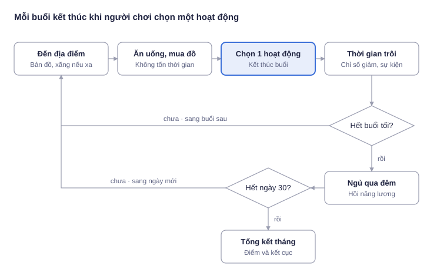

# 30 Ngày Sài Gòn · Tài liệu thiết kế trò chơi

Phiên bản tài liệu: 0.3.0 · Cập nhật: 21/10/2026

**30 Ngày Sài Gòn** là game mô phỏng chi tiêu theo lượt có cốt truyện. Người chơi vào vai một tân sinh viên năm nhất (tự đặt tên và chọn giới tính, mặc định là Minh) vừa học vừa làm thêm, sống qua tháng đầu tiên ở Sài Gòn: đi học đầy đủ, làm part-time, chi tiêu khéo từ tiền bố mẹ chu cấp, và giữ cho mình đủ no, đủ khỏe, đủ vui.

## Mục lục

1. [Tổng quan](#1-tổng-quan)
2. [Cốt truyện và nhân vật](#2-cốt-truyện-và-nhân-vật)
3. [Vòng lặp chơi](#3-vòng-lặp-chơi)
4. [Hệ thống chỉ số](#4-hệ-thống-chỉ-số)
5. [Địa điểm và hành động](#5-địa-điểm-và-hành-động)
6. [Túi đồ và vật phẩm](#6-túi-đồ-và-vật-phẩm)
7. [Nhiệm vụ và điểm học tập](#7-nhiệm-vụ-và-điểm-học-tập)
8. [Sự kiện](#8-sự-kiện)
9. [Kinh tế và cân bằng](#9-kinh-tế-và-cân-bằng)
10. [Tính điểm và kết cục](#10-tính-điểm-và-kết-cục)
11. [Giao diện](#11-giao-diện)

---

## 1. Tổng quan

| Hạng mục | Mô tả |
| --- | --- |
| Thể loại | Mô phỏng đời sống, quản lý tài nguyên theo lượt; điều khiển bằng bấm chọn (point-and-click) |
| Nền tảng | Trình duyệt web trên máy tính và điện thoại nằm ngang |
| Hình ảnh | Pixel art: cảnh 320×180, giao diện trên lưới 640×360, phóng to nguyên lần. Cảnh đổi theo địa điểm, buổi và tiến độ; một số hành động có cảnh riêng. Quy tắc hình ảnh và bảng màu: [DESIGN_SPEC.md](DESIGN_SPEC.md) |
| Độ dài một ván | 30 ngày × 4 buổi = 120 lượt |
| Ngôn ngữ | Tiếng Việt, giá cả theo TP.HCM |
| Mục tiêu trải nghiệm | Người chơi tự cảm nhận đánh đổi giữa học, làm thêm, chi tiêu và chăm sóc bản thân |

## 2. Cốt truyện và nhân vật

Minh (hoặc tên người chơi đặt), 18 tuổi, rời Tuy Hòa vào Sài Gòn học năm nhất ngành Thiết kế, ở ghép phòng trọ với Khoa. Mọi chỗ lời thoại, nhiệm vụ, nhật ký và kết cục nhắc "Minh" đều thay bằng tên người chơi; lời thoại dùng xưng hô trung tính nên không đổi theo giới tính. **Bố mẹ gửi 3.000.000đ cho tháng đầu**, đã gồm tiền nhà. Phần còn lại Minh phải tự lo bằng việc làm part-time ở cửa hàng tiện lợi. Ba mục tiêu song song: **học đầy đủ** để qua bài kiểm tra giữa kỳ, **tự lập tài chính** không xin thêm tiền nhà, và **tự tay mua quà sinh nhật mẹ** (ngày 30) bằng tiền mình làm ra.

| Nhân vật | Mã trong code | Vai trò |
| --- | --- | --- |
| Minh (tên do người chơi đặt) | `self` | Nhân vật chính, tân sinh viên năm nhất, nam hoặc nữ |
| Cô Tư, chủ nhà trọ | `tu` | Thu tiền nhà, hướng dẫn những việc đầu tiên |
| Thầy Hải, cố vấn học tập | `hai` | Theo dõi chuyên cần, ra bài kiểm tra giữa kỳ |
| Chị Mai, quản lý cửa hàng tiện lợi | `mai` | Phỏng vấn, xếp ca, trả lương part-time |
| Chị Linh, trưởng CLB | `linh` | Mời dự đêm nhạc chào tân sinh viên |
| Khoa, bạn cùng phòng | `khoa` | Rủ đi chơi, hỏi mượn tiền |
| Mẹ | `me` | Gửi tiền đầu tháng, gọi điện hỏi thăm, sinh nhật ngày 30 |

| Chương | Ngày | Nội dung |
| --- | --- | --- |
| 1. Tân sinh viên | 1–7 | Nhận phòng trọ, buổi học đầu tiên, phỏng vấn xin việc làm thêm, tự nấu ăn, giữ đủ tiền nhà |
| 2. Vừa học vừa làm | 8–14 | Sáng lên lớp, chiều tối đi làm; đêm nhạc CLB tối thứ Bảy; ví mỏng dần trước ngày lương |
| 3. Lương part-time đầu tiên | 15–21 | Nhận lương ngày 15; cám dỗ tiêu xài; ôn bài ở thư viện; mẹ gọi hỏi thăm; cà phê với Khoa |
| 4. Về đích | 22–30 | Kiểm tra giữa kỳ sáng ngày 29; mua quà sinh nhật mẹ; về đích khỏe mạnh |

## 3. Vòng lặp chơi



| Việc trong một buổi | Giới hạn | Tốn thời gian |
| --- | --- | --- |
| Đi tới địa điểm khác | Không giới hạn | Không |
| Ăn một bữa | Tối đa 1 lần | Không |
| Uống, dùng thuốc | Không giới hạn | Không |
| Mua đồ, việc tiền bạc (ứng lương, xin tiền) | Không giới hạn | Không |
| Hoạt động chính (lên lớp, làm ca, nghỉ, giải trí…) | Đúng 1 lần | Có, sang buổi sau |

**Lịch tuần của Minh** (ngày 1 là thứ Hai):

| Buổi | Thứ Hai – thứ Sáu | Thứ Bảy, Chủ Nhật |
| --- | --- | --- |
| Sáng | **Lên lớp** (bắt buộc, vắng bị trừ điểm học tập) | Ca part-time hoặc tự do |
| Trưa | Căng tin, thư viện, nghỉ trưa | Tự do |
| Chiều | Ca part-time, thư viện, CLB | Ca part-time hoặc tự do |
| Tối | Ca part-time (lương cao hơn) hoặc nghỉ | Ca part-time hoặc tự do |

Qua đêm: năng lượng hồi, độ no giảm 10, đồ hết hạn bị bỏ, phòng bừa thêm. **Bụng đói khi đi ngủ** xét theo độ no lúc người chơi chọn hành động cuối ngày (đi ngủ sớm hoặc bất kỳ hành động buổi tối), trước mọi lần trừ: dưới 30 thì ngủ không ngon (năng lượng hồi 35 thay vì 50, tinh thần −6, sức khỏe −2). Sáng hôm sau hóa đơn đến hạn tự trừ và có 2 việc hằng ngày mới.

## 4. Hệ thống chỉ số

| Chỉ số | Khởi đầu | Vai trò | Tự thay đổi |
| --- | --- | --- | --- |
| Độ no `no` | 70 | Ràng buộc sinh tồn | −9 mỗi buổi, −10 qua đêm |
| Năng lượng `nl` | 80 | Sức học và làm | −4 mỗi buổi; ngủ +50 (+35 nếu độ no lúc đi ngủ dưới 30) |
| Tinh thần `tt` | 65 | Lương ca và điểm cuối tháng | −2 mỗi buổi |
| Sức khỏe `sk` | 80 | Hậu quả dài hạn | +2 mỗi đêm ngủ no |

**Ngưỡng nguy hiểm (dưới 25):** độ no < 25 → tinh thần −4, sức khỏe −2 mỗi buổi · năng lượng < 15 → tinh thần −3, sức khỏe −2, lương ca còn một nửa · tinh thần < 25 → lương ca −20k · sức khỏe < 40 → 45% bị ốm mỗi sáng · sức khỏe = 0 → nhập viện 1.200.000đ, mất trọn ngày.

**Lợi ích giảm dần:** ăn khi độ no > 80 chỉ được 50%; giải trí khi tinh thần > 85 chỉ được 60%.

**Độ bừa bộn phòng** (chỉ số ẩn 0–100, hiện bằng 3 vạch trong khung lịch và bằng chính căn phòng):

| Mức | Ngưỡng | Ảnh hưởng | Dọn phòng |
| --- | --- | --- | --- |
| Gọn gàng | 0–33 | Sáng hôm sau tinh thần +2 | Tinh thần +5 |
| Hơi bừa | 34–66 | Mỗi buổi ở phòng tinh thần −1 | Tinh thần +8 |
| Bừa bộn | 67–100 | Mỗi buổi ở phòng tinh thần −2; ngủ hồi 40 năng lượng thay vì 50 | Tinh thần +12 |

Tăng +10 mỗi đêm, +6 mỗi bữa ăn trong phòng, +4 mỗi lần nấu (nấu là một bữa nên tổng +10), +2 mỗi buổi ở phòng. Dọn phòng −50, năng lượng −6, mất một buổi.

## 5. Địa điểm và hành động

| Địa điểm | Mở cửa | Đi lại | Hành động chính |
| --- | --- | --- | --- |
| Phòng trọ `home` | Cả ngày | 0 | Đặt đồ ăn (68k), ngủ trưa, lướt mạng, dọn phòng, nhận vẽ thuê (+80k, từ chiều), ngủ sớm; **Tiền bạc** mở điện thoại: tin nhắn, gọi xin thêm tiền bố mẹ (+500k), ví, đặt đồ ăn |
| Quán ăn `street` | Cả ngày | 0 | Cơm tấm 40k, phở 55k, bún bò 75k, mua bánh mì/xôi, trà đá, ăn ốc buổi tối 150k |
| Chợ `market` | Sáng–chiều | 0 | Mua nguyên liệu, mì gói, trái cây, sữa, thuốc; dạo chợ |
| Công viên `park` | Cả ngày | 0 | Chạy bộ (không chạy buổi trưa), đi dạo, ghế đá, bắp xào |
| Cà phê `cafe` | Cả ngày | 5k | Cà phê tại quán, mua mang về, đọc sách 45k, cà phê với Khoa (nhiệm vụ) |
| Trường đại học `school` | T2–T6, sáng–chiều | 6k | Lên lớp (sáng), học thư viện (trưa, chiều), sinh hoạt CLB (chiều), căng tin 25k (trưa), chợp mắt ở ghế đá; kiểm tra giữa kỳ sáng ngày 29 |
| Cửa hàng tiện lợi `store` | 24 giờ | 0 | Phỏng vấn xin việc; làm ca part-time; xin ứng lương 300k; cơm hộp 30k; mua mì, cà phê lon, sữa |
| TTTM `mall` | Trưa–tối | 12k | Buffet 199k, xem phim 110k, quần áo 350k, đi dạo (35% gặp giày sale), mua quà sinh nhật mẹ 300k (nhiệm vụ) |

Hết tiền xăng thì đi bộ: năng lượng −8, tinh thần −2. Xe hỏng: phí đi lại ×3 trong 4 ngày. Trên bản đồ, 4 nơi miễn phí nằm quanh phòng trọ, 3 nơi tốn tiền xa dần theo giá. Trang phục: áo xanh ngày thường, áo cam cuối tuần, đồng phục xanh lá khi ở cửa hàng sau khi đã được nhận việc (nữ mặc váy).

**Ca part-time** (chỉ sau khi phỏng vấn):

| Ca | Khi nào | Lương | Hao tổn |
| --- | --- | --- | --- |
| Ca sáng | Thứ Bảy, Chủ Nhật | 90.000đ | Năng lượng −20, tinh thần −3, no −4 |
| Ca chiều | Mọi ngày | 90.000đ | Năng lượng −20, tinh thần −3, no −4 |
| Ca tối | Mọi ngày | 110.000đ | Năng lượng −28, tinh thần −4, sức khỏe −2, no −4 |

Năng lượng dưới 15: lương ca còn một nửa. Tinh thần dưới 25: lương ca −20.000đ.

## 6. Túi đồ và vật phẩm

Túi 12 ô. Đồ ăn chiếm lượt ăn của buổi; đồ uống và thuốc dùng tự do. Đồ hết hạn bị bỏ cuối ngày.

| Vật phẩm | Loại | Giá | Hiệu ứng | Hạn | Nơi dùng |
| --- | --- | --- | --- | --- | --- |
| Bánh mì thịt | Đồ ăn | 20k | no +22, tt +1 | 1 ngày | Mọi nơi |
| Xôi gà | Đồ ăn | 25k | no +28, tt +2 | 1 ngày | Mọi nơi |
| Mì gói | Đồ ăn | 30k/5 | no +24, tt −2, sk −4 (gói thứ 2 trong ngày −8) | Không | Phòng trọ, cửa hàng |
| Nguyên liệu | Đồ ăn | 95k/3 | no +36, sk +3, tt +3, nl −3 | 3 ngày | Phòng trọ |
| Trái cây | Đồ ăn | 25k | no +12, sk +5, tt +2 | 2 ngày | Mọi nơi |
| Bánh ngọt | Đồ ăn | 30k | no +15, tt +6 | 1 ngày | Mọi nơi |
| Cà phê lon | Đồ uống | 18k | nl +12, tt +2 | Không | Mọi nơi |
| Sữa tươi | Đồ uống | 12k | no +8, nl +4, sk +3 | 3 ngày | Mọi nơi |
| Thuốc cảm | Thuốc | 45k | sk +12, nl −2 | Không | Mọi nơi |

Túi khởi đầu: 3 mì gói, 1 nguyên liệu (cô Tư cho), 1 cà phê lon.

## 7. Nhiệm vụ và điểm học tập

| Ch. | ID | Nhiệm vụ | Giao | Điều kiện | Hạn | Thưởng |
| --- | --- | --- | --- | --- | --- | --- |
| 1 | `q1_class` | Buổi học đầu tiên | Thầy Hải | Lên lớp sáng ngày 1 | 1 | tt +5 |
| 1 | `q1_job` | Tìm việc làm thêm | Chị Mai | Phỏng vấn ở cửa hàng | 3 | tt +6 |
| 1 | `q1_cook` | Bữa cơm tự nấu đầu tiên | Cô Tư | Nấu 1 bữa ở phòng trọ | 4 | tt +6, sk +3 |
| 1 | `q1_rent` | Tiền nhà cho cô Tư | Cô Tư | Đủ 1,2tr sáng ngày 5 | 5 | tt +4, 2 trái cây |
| 2 | `q2_class` | Không bỏ buổi học nào | Thầy Hải | Lên lớp 5 buổi ngày 8–12 | 12 | tt +6 |
| 2 | `q2_shift` | Quen việc ở cửa hàng | Chị Mai | 4 ca part-time ngày 8–14 | 14 | tt +5, thưởng 100k vào lương |
| 2 | `q2_club` | Đêm nhạc chào tân sinh viên | Chị Linh | Dự đêm nhạc tối ngày 13 (vé 100k) | 13 | tt +6 |
| 2 | `q2_mood` | Đừng để mình kiệt quệ | Minh | Tinh thần ≥ 30 suốt ngày 8–14 | 14 | tt +5, sk +3 |
| 3 | `q3_study` | Ôn bài ở thư viện | Thầy Hải | 3 buổi thư viện ngày 15–21 | 21 | tt +5 |
| 3 | `q3_indep` | Tự lập tài chính | Minh | Không xin thêm tiền bố mẹ | 21 | tt +6 |
| 3 | `q3_khoa` | Cà phê với Khoa | Khoa | Gặp Khoa chiều ngày 20 hoặc 21 | 21 | tt +8 |
| 4 | `q4_exam` | Kiểm tra giữa kỳ | Thầy Hải | Có mặt sáng ngày 29, đạt ≥ 55 điểm học tập | 29 | tt +8 |
| 4 | `q4_gift` | Quà sinh nhật mẹ | Mẹ | Mua quà 300k ở TTTM | 30 | tt +15 |
| 4 | `q4_health` | Về đích khỏe mạnh | Minh | Sức khỏe ≥ 50 cuối ngày 30 | 30 | Điểm cao hơn |

Quá hạn chưa xong thì thất bại; nhiệm vụ dạng "không được làm" thất bại ngay khi vi phạm.

**Việc hằng ngày** (mỗi việc xong: tt +3): ngày thường "Lên lớp buổi sáng" + "Ăn ít nhất 2 bữa" (hoặc "Nấu một bữa ở nhà"); cuối tuần "Làm ít nhất 1 ca part-time" (hoặc "Làm một việc thư giãn" khi chưa có việc) + "Tiêu dưới 100k hôm nay".

**Điểm học tập** (0–100):

```
điểm = round(số_buổi_lên_lớp / 22 × 61) + 3 × min(số_buổi_thư_viện, 8) + 5 × nhiệm_vụ_học_tập_xong − 2 × số_buổi_vắng
```

Nhiệm vụ học tập: `q1_class`, `q2_class`, `q3_study`. Bài kiểm tra giữa kỳ sáng ngày 29 chấm theo điểm học tập lúc đó: ≥ 75 giỏi · 55–74 đạt · < 55 không đạt · vắng mặt phải thi lại.

## 8. Sự kiện

**Cốt truyện (ngày cố định):** ngày 1 tin nhắn của mẹ và nhận phòng (cô Tư) · lần đầu tới trường (thầy Hải) · phỏng vấn xin việc (chị Mai) · ngày 5 thu tiền nhà · ngày 11 tối flash sale 450k · ngày 13 tối đêm nhạc chào tân sinh viên (vé 100k hoặc ở nhà) · ngày 15 lương part-time kỳ 1 · ngày 18 tối mẹ gọi hỏi tiền (từ chối, hoặc xin thêm 500k) · ngày 28 Khoa trả tiền (65%) · ngày 29 sáng kiểm tra giữa kỳ.

**Theo điều kiện:** ốm (sk < 40, sáng; khám 200k có giấy nghỉ học) · đau bụng (≥ 2 gói mì/ngày) · ngất (sk = 0) · giày sale (đi dạo TTTM) · chị Mai khen +100k (≥ 8 ca, đang ở cửa hàng).

**Ngẫu nhiên** (22% mỗi buổi, xét lúc bắt đầu buổi theo nơi đang đứng): lớp rủ đi lẩu 150k · xe hỏng 250k hoặc xe ôm 4 ngày · Khoa mượn 300k · rơi điện thoại 400k · sinh nhật bạn cùng lớp 150k · nhặt được 50k.

| Sự kiện | Khi nào |
| --- | --- |
| Mưa to bất chợt | Vừa đi tới nơi khác bằng bản đồ, buổi trưa hoặc chiều, xác suất 15%; hoặc đang ở công viên buổi trưa hoặc chiều. Tối đa 1 lần mỗi ngày |
| Quán hết chỗ | Đang ở quán cà phê, buổi trưa đến tối; 1 lần trong tháng. Ngồi chung với một anh năm ba ngành Thiết kế (tinh thần +6) hoặc mua mang về (tinh thần −1) |
| Mời làm thẻ thành viên | Đang ở TTTM, buổi trưa đến tối; 1 lần trong tháng. Đăng ký thẻ 99k (tinh thần +2, điểm tích lũy chưa dùng được trong tháng) hoặc để sau (tinh thần +1) |

## 9. Kinh tế và cân bằng

Trò chơi chỉ kéo dài một tháng nên **không có tính năng gửi tiết kiệm**. Tiền còn lại cuối tháng được tính thẳng vào tài sản.

| Thu | Số tiền |
| --- | --- |
| Bố mẹ chu cấp đầu tháng | 3.000.000đ (gồm tiền nhà) |
| Ca part-time | 90.000đ, ca tối 110.000đ |
| Lương part-time kỳ 1 | Trả ngày 15 cho các ca từ đầu tháng |
| Lương part-time kỳ 2 | Cộng vào tài sản khi tổng kết ngày 30 |
| Thưởng chăm chỉ | 200.000đ nếu làm từ 18 ca |
| Vẽ thuê | 80.000đ |

| Chi cố định | Ngày | Số tiền |
| --- | --- | --- |
| Tiền nhà (phòng ghép) | 5 | 1.200.000đ |
| Điện, nước, internet | 10 | 200.000đ |
| Giáo trình và quỹ lớp | 20 | 300.000đ |

Thiếu tiền trả hóa đơn (và viện phí): trừ hết tiền trong ví, tinh thần −12, không ghi nợ, không phạt. Thẻ sang ngày báo bằng dòng đỏ; thiếu tiền nhà ngày 5 thì nhiệm vụ "Tiền nhà cho cô Tư" thất bại và cô Tư nhắc khéo ở kết cục.

**Các cách xoay xở khi kẹt tiền:**

| Cách | Hoạt động | Hệ quả |
| --- | --- | --- |
| Xin ứng lương | Ứng 300k từ lương đang chờ, mỗi kỳ 1 lần, không lãi | Cách lành mạnh |
| Xin thêm tiền bố mẹ (gọi điện ở phòng trọ, hoặc khi mẹ gọi ngày 18) | +500k, tối đa 2 lần | Tinh thần −8, thất bại nhiệm vụ Tự lập |

Ngân sách nửa đầu tháng: (3,0tr − 1,2tr − 0,2tr) / 14 ngày ≈ **114.000đ/ngày** trước khi có lương part-time.

**Kết quả mô phỏng** (`npm run sim`, 150 ván mỗi kiểu, v0.3.0):

| Bot | Điểm trung vị | Hạng S / A / B / C / D | Nhiệm vụ TB | Điểm học tập | Ca part-time | Tài sản cuối | Tinh thần TB | Dọn phòng |
| --- | --- | --- | --- | --- | --- | --- | --- | --- |
| Thận trọng | 822 | 81% / 17% / 1% / 0% / 0% | 12,1/14 | 100 | 36 | ~1,82tr | 83 | 11 lần |
| Ví trống ngày 5 | 434 | 0% / 0% / 3% / 41% / 55% | 9,1/14 | 100 | 33 | ~1,43tr | 35 | 9 lần |
| Ngẫu nhiên | 170 | 100% hạng D | 3,4/14 | 0 | 2 | ~0,09tr | 33 | 0 |

So với v0.2.0 (Thận trọng 824 điểm, 12/14 nhiệm vụ, ~1,97tr), bot thận trọng giữ nguyên độ khó; tài sản giảm nhẹ vì phải dành buổi tối dọn phòng (khoảng 3 ngày một lần). Bot ngẫu nhiên không còn tài sản âm vì đã bỏ nợ.

**Bỏ nợ có tạo lỗ hổng không?** Bot "Ví trống ngày 5" chơi như bot thận trọng nhưng chiều tối ngày 4 dồn hết tiền vào thuốc, mì, cà phê lon để ví trống khi trừ tiền nhà. Bot né được 1,2tr tiền nhà nhưng đói tới ngày lương, tinh thần trung bình chỉ 35 và điểm trung vị 434 so với 822. Vì vậy giữ mức phạt −12 tinh thần, không cần phạt tăng theo số tiền thiếu.

Bot thận trọng thường không đủ tiền dự đêm nhạc ngày 13 và mua quà mẹ (bot chỉ chi khi ví còn dư nhiều), cho thấy áp lực tiền bạc trước ngày lương vẫn còn.

## 10. Tính điểm và kết cục

```
Điểm = 1000 × T^0,35 × N^0,2 × M^0,25 × S^0,2
```

| | Yếu tố | Quy đổi 0–1 |
| --- | --- | --- |
| T | Tài sản = tiền mặt + lương part-time kỳ 2 + thưởng chăm chỉ | ÷ 2.500.000, tối đa 1,25 |
| N | Độ no trung bình cả tháng | ÷ 100 |
| M | Tinh thần trung bình cả tháng | ÷ 100 |
| S | Sức khỏe cuối ngày 30 | ÷ 100 |

Hạng: S ≥ 800 · A ≥ 700 · B ≥ 580 · C ≥ 450 · D.

Kiểu người chơi: Cỗ máy làm thêm (sức khỏe thấp, từ 24 ca) · Kẻ khổ hạnh · Sống cho hiện tại · Người cân bằng · Người sống sót.

Kết cục theo nhân vật: thầy Hải (kết quả kiểm tra giữa kỳ), chị Mai (số ca đã làm), mẹ (có nhận quà không, có phải gửi thêm tiền không), Khoa và chị Linh (nếu đã gặp), cô Tư (có thiếu tiền nhà ngày 5 hay không).

Thành tựu: Chuyên cần (không vắng buổi học), Đầu bếp tại gia (15 bữa tự nấu), Tự lập tài chính (không xin thêm tiền bố mẹ), Chăm chỉ làm thêm (18 ca), Hoàn thành mọi nhiệm vụ, Fan cứng mì gói.

## 11. Giao diện

Thiết kế chi tiết từng màn hình nằm trong `design/`, đặc tả trong [DESIGN_SPEC.md](DESIGN_SPEC.md).

**Luồng màn hình:** trang bìa → tạo nhân vật (Nam/Nữ, tên 1–12 ký tự chỉ gồm chữ cái và khoảng trắng) → chuyển cảnh ngày 1 (có nút Bỏ qua) → thẻ chương 1 → vào game. Mỗi sáng từ ngày 2 có thẻ sang ngày; ngày 8, 15, 22 thêm thẻ chương. Ngày 30 kết thúc bằng màn tổng kết.

**HUD** (một màn hình 16:9, lưới 640×360):

| Vị trí | Thành phần |
| --- | --- |
| Trên trái | Thứ, chương, ngày, 4 buổi, nơi đang đứng, độ bừa bộn phòng (khi ở phòng trọ) |
| Trên phải | Ví và lương chờ; nhiệm vụ đang theo dõi, hạn, việc hôm nay |
| Dưới trái | 4 chỉ số dạng cột, vạch đỏ ở mức 25 |
| Giữa dưới | Thanh lệnh: Ăn uống · Mua · Hoạt động · Tiền bạc (phím 1–4) · Túi đồ · Lịch · Nhiệm vụ · Bản đồ · Menu (Nhật ký, Luật chơi, Màn hình chính) |
| Giữa trên | Cảnh báo kèm nút làm ngay: giờ học, nơi đóng cửa, phòng bừa bộn |

**Cửa sổ:** Bản đồ toàn màn hình; Túi đồ, Lịch, Nhiệm vụ chung một khung có tab; hội thoại có chân dung, lời thoại hiện dần, chọn bằng chuột hoặc phím số; điện thoại trong game ở phòng trọ; tổng kết có đồ thị 30 ngày.

**Điện thoại nằm ngang** (`pointer: coarse`, `orientation: landscape`): cảnh phủ kín màn hình, giao diện chừa vùng an toàn, 3 nút hành động 64×56 ở góc phải dưới, công cụ 48×48 ở góc trái dưới, menu mở thành ngăn bên phải. Điện thoại dọc hiện lời nhắc xoay ngang.

**Trợ năng:** phím tắt B, L, J, M, N, 1–4, Space, Esc; vùng có `aria-label`, cửa sổ có tiêu điểm bàn phím; tắt hoạt ảnh khi bật `prefers-reduced-motion`.

**Âm thanh:** nhạc nền theo màn hình và địa điểm, dịu lại buổi tối; hiệu ứng cho thao tác và kết quả. Chỉ bật sau lần bấm "Bắt đầu câu chuyện" hoặc "Chơi tiếp" đầu tiên. Menu → Âm thanh chỉnh Nhạc nền, Hiệu ứng, Tắt tiếng (lưu ở khóa `ba-muoi-ngay-sg-audio`). Chi tiết: DESIGN_SPEC mục 6.

Tiến trình tự lưu vào `localStorage` (khóa `ba-muoi-ngay-sg-v5`) sau mỗi hành động. Bản lưu của v0.2.0 (khóa `v4`) không dùng được.
